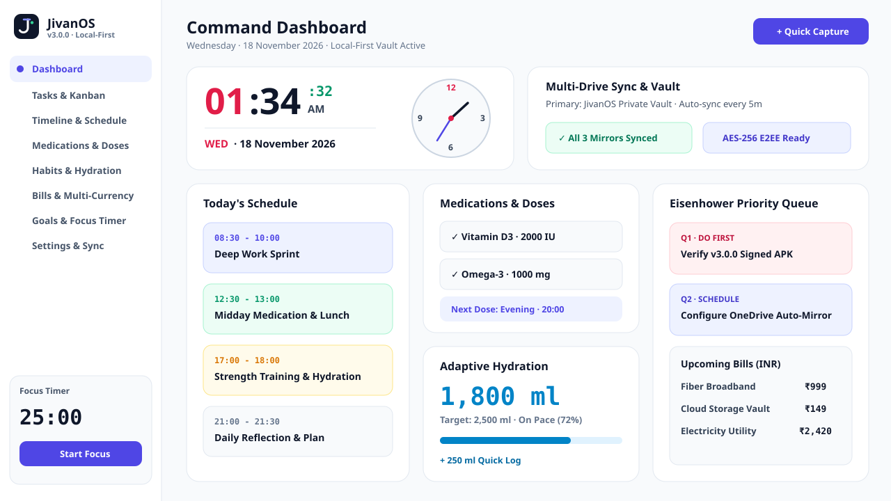
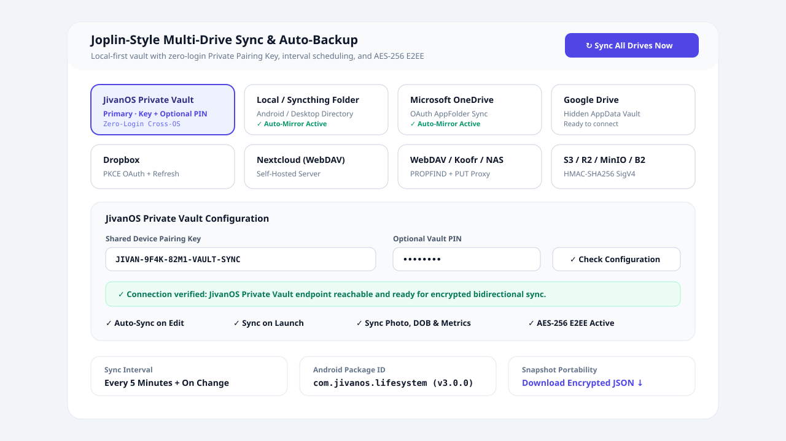
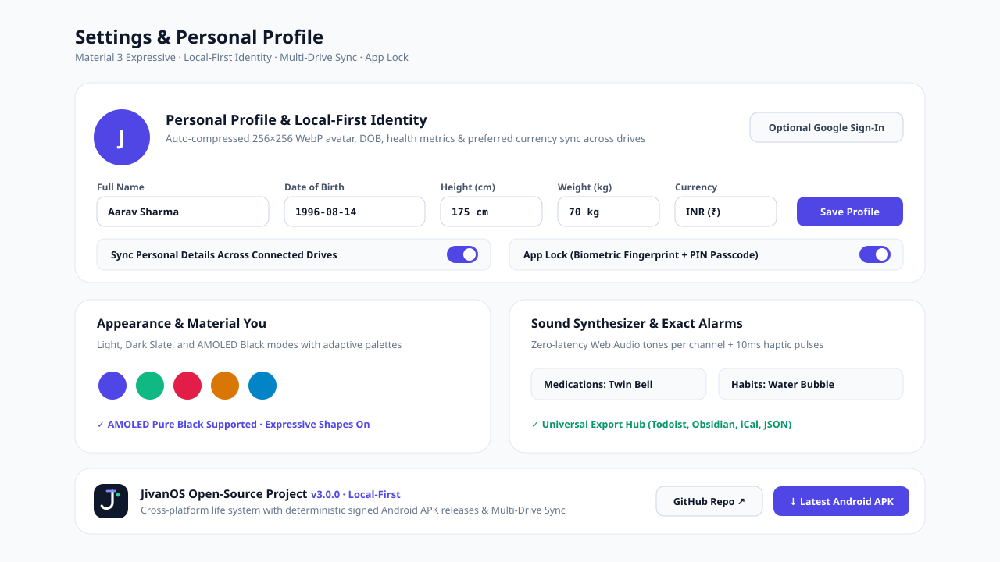

# JivanOS v3.0.0

**JivanOS** is a privacy-first, local-first personal life operating system engineered for **Android (APK)**, **iOS (PWA)**, **Windows**, **macOS**, and **Linux**. Inspired by Joplin's resilient open-source sync architecture, JivanOS keeps all tasks, schedules, health metrics, medications, habits, hydration, bills, goals, and personal profile data stored on your device first—with seamless, zero-login multi-drive synchronization and end-to-end encryption across every device.

---

## Screenshots

### Command Dashboard & Daily Timeline


### Joplin-Style Multi-Drive Sync & Private Vault


### Settings, Personal Profile & App Lock


---

## Complete Feature Suite

### Productivity, Planning & Focus
- **Command Dashboard & Live Analog/Digital Clock**: Unified daily overview with adaptive time formatting, quick capture inbox, upcoming bills, and live sync status.
- **Tasks, Kanban & Eisenhower Matrix**: Organize tasks across customizable workflow stages (`To Do`, `In Progress`, `Waiting`, `Review`, `Done`) or prioritize via the 4-quadrant Eisenhower Matrix (`DO`, `PLAN`, `PASS`, `SKIP`).
- **Hourly Timeline & Daily Schedule**: Drag-free time blocking (`hourly`, `priority`, `deadline`, and printable views) with recurring schedules and conflict-free calendar integration.
- **Pomodoro Focus Timer & Analytics**: Integrated sidebar & dedicated focus sessions tied directly to tasks, plus productivity and streak analytics.
- **Goals, Tags & Daily Wisdom Quotes**: Long-term milestone tracking, cross-module tag filtering, and customizable quote typography & transition cards.

### Health, Habits & Finance
- **Medications & Dose Logger**: Flexible dosage frequencies (`daily`, `twice_daily`, `thrice_daily`, `alternate_days`, `every_N_days`, `custom_dates`), refill threshold alerts, and `taken` / `skipped` / `snoozed` logs.
- **Habits, Routines & Adaptive Hydration**: Streak counters, morning/evening routine templates, hydration unit normalization (`ml` / `litres`), and pace-aware water reminders.
- **Bills & Multi-Currency Ledger**: Recurring bill due alerts and expense summaries supporting `INR`, `USD`, `EUR`, `GBP`, `AED`, `JPY`, `CAD`, and `AUD`.

### Privacy, Sync, Audio & Portability
- **Joplin-Style Multi-Drive Sync (No Mandatory Login)**:
  - **JivanOS Private Vault**: Zero-OAuth cross-device sync using a generated **Pairing Key** + optional **Vault PIN**.
  - **Cloud & Self-Hosted Drives**: **Microsoft OneDrive**, **Google Drive** (App Data Folder), **Dropbox**, **Nextcloud** (WebDAV), **WebDAV / Koofr / NAS**, **S3 / Cloudflare R2 / MinIO / Backblaze B2**, **Local / Syncthing Folder**, and optional **JivanOS Cloud (Firebase)**.
  - **Check Configuration Diagnostics**: Live connection verification before syncing.
  - **Auto-Sync & Backup Mirrors**: Background sync on interval (`5`, `15`, `30`, `60` min), debounced sync on edits, startup pull checks, client-side **AES-256-GCM (PBKDF2)** encryption passphrase, and multi-drive auto-backup mirroring.
  - **Personal Profile Sync**: Bidirectional sync for compressed WebP avatar photo, name, nickname, DOB, gender, height, weight, currency, and bio.
- **Security & App Lock**: Whole-app biometric/PIN passcode lock with auto-lock on resume and vault master passphrase protection.
- **Sound Synthesizer & Tactile Haptics**: Zero-latency offline Web Audio synthesizer with per-channel custom alarm/notification tones and 10ms haptic feedback.
- **Universal Export Hub**: Export data to Todoist, Super Productivity, Google Tasks, Obsidian Markdown, iCalendar (`.ics`), and encrypted JSON snapshots.
- **Material 3 Expressive Appearance**: Light, Dark Slate, and AMOLED Pure Black modes with expressive squircle/cookie/clover shapes and adaptive palettes.

---

## Multi-OS Compatibility

| Platform | Runtime | Offline Local-First | Sync Support |
| :--- | :--- | :--- | :--- |
| **Android** | Native Capacitor APK (`com.jivanos.lifesystem`) | Yes | Private Vault, Syncthing/Local Folder, OneDrive, GDrive, Dropbox, Nextcloud, WebDAV, S3 |
| **iOS / iPadOS** | Installable PWA (Safari Share → Add to Home Screen) | Yes | Private Vault, OneDrive, GDrive, Dropbox, Nextcloud, WebDAV, S3, Firebase |
| **Windows / macOS / Linux** | Desktop Web / Installable Chrome & Edge PWA | Yes | All 9 targets including direct Local / Syncthing Folder access |

---

## Android APK Installation & Upgrades (`v3.0.0+`)

- Starting in **`v3.0.0`**, GitHub Actions (`/.github/workflows/build-android-apk.yml`) signs every APK deterministically with the pinned repository release keystore (`com.jivanos.lifesystem`) and increments `versionCode` (`30000 + run_number`).
- **Upgrading from `v2.1.x` (One-Time Step)**: Because `v2.1.x` APKs used an ephemeral runner keystore, Android will reject an over-the-top update from `v2.1.x` with a package conflict. Export a local JSON backup (or sync to a drive), uninstall `v2.1.x` once, and install `v3.0.0`.
- **Upgrading from `v3.0.0` onward**: Every future `v3.0.x` APK updates smoothly in place without uninstalling or losing local data.

---

## OAuth Callback URLs (Self-Hosting / Cloud Sync)

When configuring OneDrive, Google Drive, or Dropbox OAuth client credentials, register the following redirect URI:
- Local development: `http://localhost:3000/auth/oauth-callback`
- Deployed instance: `https://<your-host>/auth/oauth-callback`

---

## Local Development & Build

```bash
# Install dependencies
npm install

# Run full-stack development server (Express API + Vite on port 3000)
npm run dev

# Build production bundle
npm run build

# Start production server
npm start
```

See [CHANGELOG.md](CHANGELOG.md) for detailed release notes.
